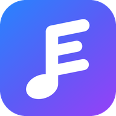
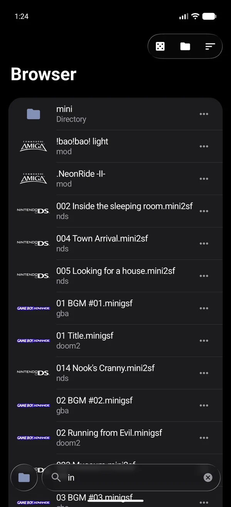
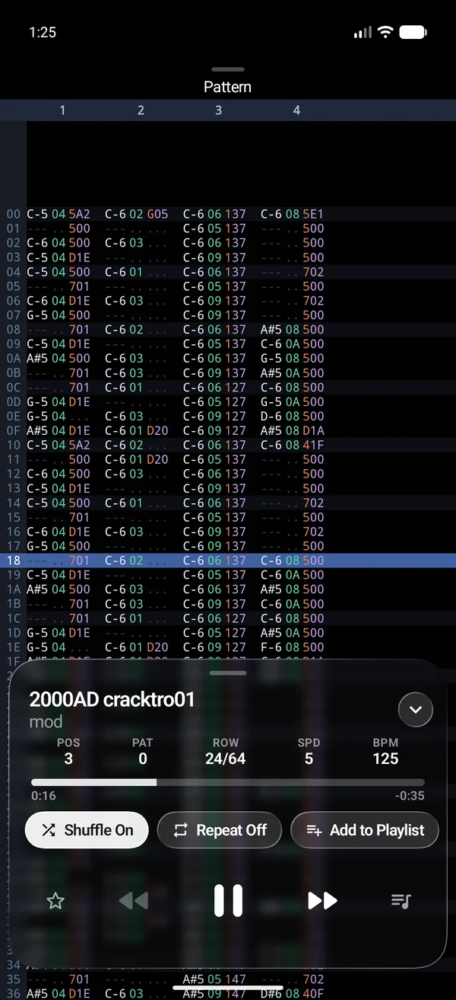
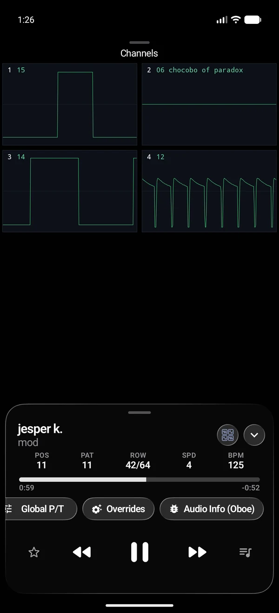
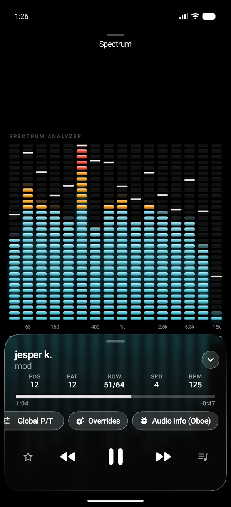
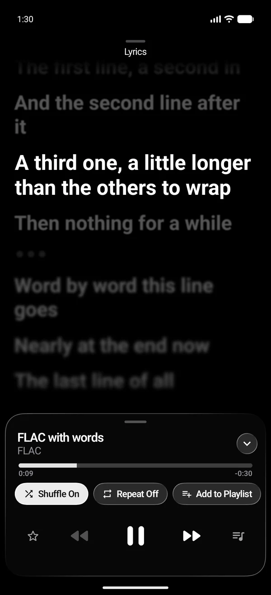
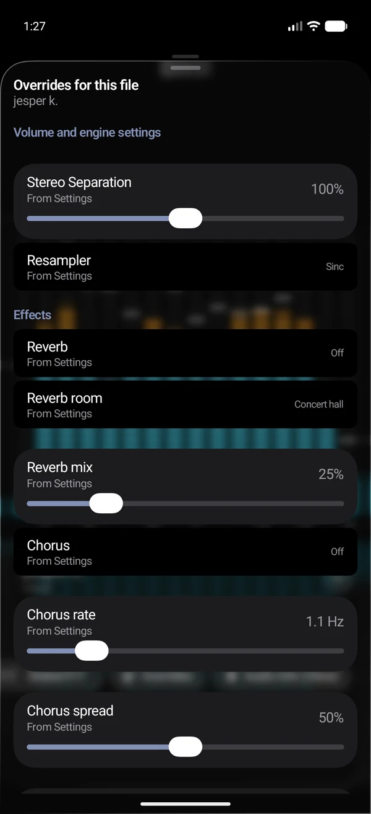
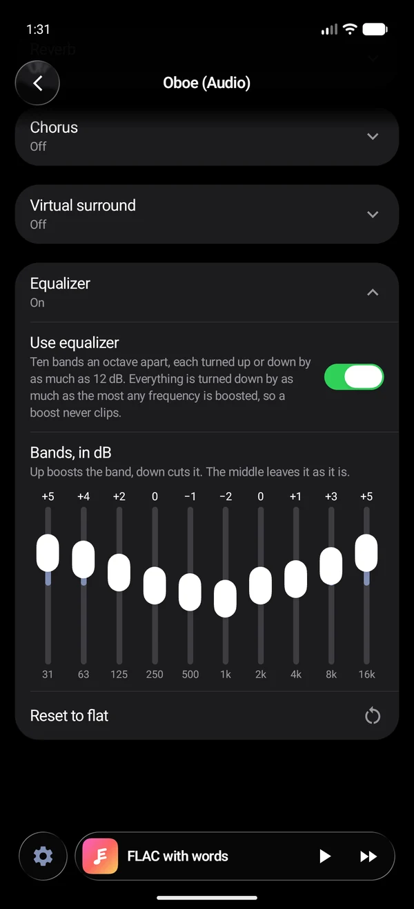
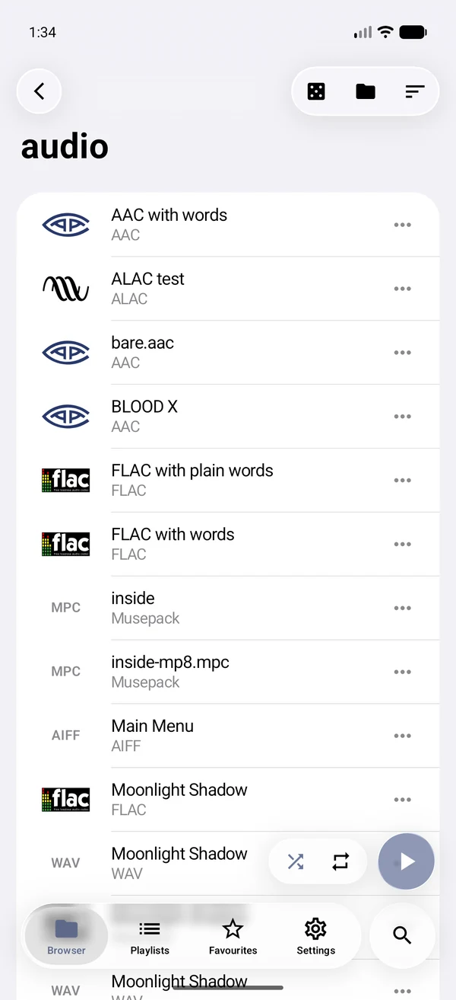

  

<h1 align="center">Exilum Player</h1>

  An Android player for tracker modules, chip music and recorded music: 
  fourteen native engines behind one interface.

  
  
  
  

  
  
  
  

Exilum Player plays the music of old computers and consoles from the files
that hold it - not recordings of it, but the tunes themselves, run through an
emulation of the machine they were written for - and plays ordinary recorded
music beside them. MOD, XM, IT and S3M; the Commodore 64, the Amiga, the NES,
the Super Nintendo, the Game Boy and Game Boy Advance, the Nintendo 64, DS and
GameCube, the PlayStation, the Sega consoles and the AdLib card; MP3, FLAC,
AAC, Ogg, Opus and the like.

## What it plays

Each file is offered to the engines in turn until one recognises it.

| Engine | Plays |
|---|---|
| [libopenmpt](https://lib.openmpt.org/libopenmpt/) | Tracker modules: MOD, XM, IT, S3M, MPTM and dozens more |
| [HivelyTracker](https://github.com/pete-gordon/hivelytracker) replayer | AHX, THX, HVL |
| [Furnace](https://github.com/tildearrow/furnace) | FUR, DMF |
| [libsidplayfp](https://github.com/libsidplayfp/libsidplayfp) | SID, PSID, RSID (Commodore 64) |
| CustomMade replayer | CM, RK, RKB (Ron Klaren's Amiga music) |
| [Game_Music_Emu](https://github.com/libgme/game-music-emu) | NSF, NSFE (NES), SPC (Super Nintendo), GBS (Game Boy) |
| [mGBA](https://mgba.io) | GSF, MINIGSF (Game Boy Advance) |
| [vio2sf](https://gitlab.com/kode54/vio2sf) | 2SF, MINI2SF (Nintendo DS) |
| [lazyusf2](https://gitlab.com/kode54/lazyusf2) | USF, MINIUSF (Nintendo 64) |
| [aopsf](https://gitlab.com/kode54/aopsf) | PSF, MINIPSF (PlayStation) |
| GameCube stream decoder (formats from [vgmstream](https://github.com/vgmstream/vgmstream)) | DSP, ADX, HPS, AST, AFC, DTK (ADP), STM, IDSP, PDT and more |
| [libvgm](https://github.com/ValleyBell/libvgm) | VGM, VGZ, S98, DRO, GYM |
| [AdPlug](https://github.com/adplug/adplug) | AdLib formats: RAD, D00, HSC, A2M, IMF, CMF and many more |
| [FFmpeg](https://ffmpeg.org) | MP3, FLAC, AAC (LC, HE, HE v2, xHE), ALAC, Ogg Vorbis, Opus, Musepack, WavPack, WAV, AIFF |

The full list, engine by engine, is in the app under Settings > About >
Supported Formats.

## Features

### Playback

- **Gapless** from one track to the next, with repeat and shuffle - of a
  folder, a playlist or the whole library.
- **Subsongs.** A file that holds several tunes - most SID, NSF and GBS files
  do - lists them all; any one of them can be a favourite of its own, under a
  name of its own.
- **A queue that is remembered.** The app can open where it was left, with
  the queue it had and the track at the second it had reached.
- **In the background,** with the system's media controls through Media3, and
  in the car through Android Auto.
- **Low-latency output** through [Oboe](https://github.com/google/oboe), with
  the audio API, sample rate and buffer length to choose.

### Pitch and tempo

Each on its own, for every engine: a tune can be played faster without rising
in pitch, or transposed without changing speed. For the emulated machines,
which have no such controls of their own, this is done on their output.

### Sound

- **Reverb** in nine rooms, **chorus**, **virtual surround** and a **ten-band
  equalizer**, on whatever is playing, whichever engine plays it.
- **Sound Check** plays every track at the same loudness, whatever its format:
  each is analysed in the background before it is played.
- **Settings for each engine**: stereo separation and resampling for the
  trackers, the Super Nintendo's echo and interpolation, the Game Boy
  Advance's low-pass filter, the Nintendo DS's interpolation, the
  PlayStation's reverb, a choice of OPL emulators for AdLib music, and more.

### Settings a file keeps for itself

Some tunes want something different from the rest: more stereo, another
resampler, a room to play in, an ending that is not where the file says it
is. The Overrides sheet in Now Playing sets these for the one file - its
engine's options, its reverb, chorus and surround, its length and its loop
points - and they are used whenever that file is played, whatever the
settings say. A setting can be put back to "from Settings" at any time.

### Views

What is playing can be watched in several views, a swipe apart:

- **Pattern** - the tracker's own view of a module, rows of notes scrolling
  past.
- **Channels** - an oscilloscope for each voice.
- **Spectrum** - a spectrum analyser.
- **Lyrics** - for recorded music, the words from the file's tags or from a
  `.lrc` file beside it, the line being sung picked out and, where the words
  are timed, lit up word by word.

### Library

- **A file browser** over the folder the music is in, with search, sorting
  and a start folder to open in.
- **The logo of what a file is from** - the console, the computer, the
  format - at the head of its row, so a folder of mixed music reads at a
  glance.
- **Playlists**, reordered by dragging, and **favourites**.

### Interface

Drawn in **Liquid Glass**, after iOS 26, on
[Kyant0's backdrop](https://github.com/Kyant0/AndroidLiquidGlass): bars and
buttons of glass that bend what is behind them and run together where they
meet, in light and dark, with the glass's opacity to choose. The bending
needs Android 13 or later; below that the glass is a plain blur.

A second style, **One UI**, is in development.

## Installing

Android 8.0 (API 26) or later, on arm64-v8a or armeabi-v7a.

When there is a release, its signed APK is on the
[Releases](../../releases) page.

## Building

Some of the engines are git submodules; clone with `--recurse-submodules`, or
run `git submodule update --init --recursive` after cloning. Local changes to
them are kept as patches in `renderer/src/main/cpp/patches` and applied by
CMake when the renderer is configured. The rest are copied in, with what was
changed recorded beside them.

Then Android Studio, or `./gradlew :app:assembleDebug` with JDK 17 or later
and the Android SDK, NDK and CMake installed.

Under the hood: Kotlin, Jetpack Compose, Navigation 3, Koin, DataStore and
Room, over a C++ renderer (JNI) that holds the engines.

## Licence

Exilum Player is free software, licensed under the
[GNU General Public License v3.0 or later](LICENSE).

It is built from third-party code under its own licences: they are listed in
[NOTICE](NOTICE), and in the app under Settings > About. The logos shown
beside files are trademarks of their owners, used only to say what a file is.

Exilum Player started as a fork of Drakmod Player by Lossy Dragon.
